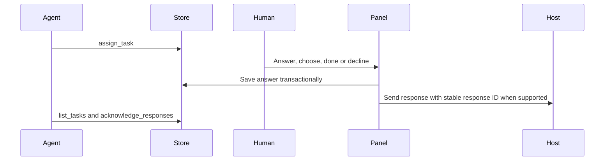

# Human in the loop

Keep the questions and actions an agent needs from you in **My tasks**, while it continues independent work. Answer when ready; the request stays available across turns, compaction and restarts.

An independent Codex plugin inspired by [Tzafrir Rehan's Human in the loop](https://github.com/tzafrir/human-in-the-loop), implemented using MCP Apps and lifecycle hooks. Display name: **Human in the loop**.

## What you can do

- **Do:** perform an action and mark it done, or explain your response.
- **Answer:** type a multiline answer.
- **Choose:** pick one of two to four options, or give another answer.
- Decline a request with a reason. The agent can withdraw an open request when it finds another way.
- Save answers while the agent works, or choose **Send now**. When idle, the panel sends through the host's message bridge if available. At the end of a busy turn, saved answers are sent together once no open request remains.
- Recover tasks from an ended conversation in the same project using an explicit panel action. Live conversations remain separate.

Five open requests per conversation. Repeated normalized titles reuse the open request. Only the main agent should assign requests; child agents report their needs to their parent.

## Requirements

- Node.js **22.18 or later**, available as `node` on the Codex process PATH, and npm.
- Codex desktop with local plugin installation, lifecycle hooks and an MCP Apps renderer. Review and trust the plugin's hooks using the host's controls.
- Message capability in the renderer for direct response delivery. Without it, responses remain saved and can be copied into the same conversation.
- This repository targets Codex only. It does not contain a Claude edition or modify application files.

## Install from source

```bash
git clone https://github.com/julien-m/human-in-the-loop.git
cd human-in-the-loop
npm ci
npm run check
npm run package
codex plugin marketplace add ./artifacts/marketplace
codex plugin add human-in-the-loop@human-in-the-loop-local
```

Keep the cloned checkout and generated marketplace available. Open a new Codex conversation, review the hooks, and ask the agent to open **Human in the loop**. A session-start hook supplies the exact scope; an unbound panel never selects a recent conversation automatically. Existing chats may need to be reopened so hooks and tools refresh.

The source checkout has root [plugin.json](plugin.json), [mcp.json](mcp.json), sources, tests and this README. `npm run package` produces an allowlisted local marketplace with self-contained JavaScript bundles; no node_modules, logs or task data enter it. `dist/` and `artifacts/` are generated and excluded from Git.

## Usage

Tell the agent: “Keep anything you need from me in Human in the loop and continue the work you can do.” The agent calls `assign_task`, which returns the panel resource. Ask to open **My tasks** whenever needed. The host controls placement; a tool call requests rendering but does not prove that the panel is visible.

The panel is currently in French. It supports keyboard-accessible buttons, multiline text, draft preservation during refresh, and a saved-response section. Polling pauses during edits, mutations and when hidden. Closing the panel leaves committed tasks and answers on disk; text not yet submitted is an in-panel draft and does not survive destruction of that panel.



The agent can also read saved responses directly. **Saved**, **host accepted**, **delivery unknown**, and **agent acknowledged** are distinct states. Acknowledgement confirms receipt, not completion of downstream work. Ambiguous sends are never automatically retried. Check the conversation, then copy the response if manual recovery is needed; response IDs let the agent avoid processing it twice.

## Persistence and privacy

Task data is local SQLite, under `$XDG_DATA_HOME/human-in-the-loop` or the platform home directory's `.local/share/human-in-the-loop`. Override the plugin directory with `HUMAN_LOOP_DATA_DIR` in the environment inherited by both hooks and server. The database is owner-readable/writable only; new data directories are created with mode 0700. SQLite uses transactions, bounded locks and per-task revisions.

No transcript is read, and there is no network listener in the plugin. Responses sent to the agent become part of its conversation and may be processed by its provider. The optional preview command starts a loopback-only demo server with synthetic data.

Do not paste secret values. Ask the user to put a secret in its intended destination and mark the task done. A heuristic holds secret-shaped text for an explicit human decision; it is not a guarantee against sensitive data. The local OS user can access the database and capabilities: UI-only tools and opaque tokens are routing guards, not a sandbox against a malicious local user or compromised host.

Ended sessions require explicit recovery; no time-based takeover of sleeping sessions occurs. Resuming the same thread restores its scope. Local history is retained on disk until the user removes the plugin data; no retention cleaner is currently included. Remove this plugin through Codex's native controls; uninstalling code does not silently erase saved data.

## Development and verification

```bash
npm ci
npm run check
npm run package
npm run preview
```

`npm run check` builds the bundles, runs the complete test suite and scans distributable text for personal paths and common credential shapes. It has a five-minute process budget. Tests cover persistence, isolation, concurrent writes, compare-and-swap, idempotence, response delivery, hooks, actual stdio MCP calls, and UI interactions. Preview is explicitly synthetic and is not native Codex evidence.

Read [the verification record](docs/verification.md) for observed results and current limits, and [the UI contract](docs/ui-contract.md) for internal tools.

## Verified limits

- This implements the interaction model using supported extension surfaces; it does not port Claude's internal TSX mod API.
- Exact panel placement, permanent visibility, automatic reopening after application restart, and native message behavior depend on the installed host. Tests of the DOM and stdio protocol cannot certify these properties.
- Automatic panel delivery requires the panel to be connected. Without it, saved responses remain available to hooks and the agent. The bounded Stop hook may continue once to consume saved responses; it does not run an endless waiting loop.
- A hook reminder does not guarantee the model will convert every prose question into a task. Enforceable scope checks protect storage; “main agent only” is also a runtime instruction and is not authenticated by MCP alone.
- The bridge has no end-to-end exactly-once delivery guarantee. Stable IDs, durable state, explicit acknowledgement and visible uncertainty prevent pretending otherwise.
- Lifecycle-hook plugins installed manually are distinct from listings accepted into OpenAI's public plugin directory. A public GitHub repository is not a directory approval.

Consult [OpenAI's plugin packaging documentation](https://developers.openai.com/plugins/build/plugins), [MCP UI extensions](https://developers.openai.com/plugins/build/extensions), and [Codex hooks](https://learn.chatgpt.com/docs/hooks) for host support.

## License

MIT. Read [the license](LICENSE) and [the notices](NOTICE). No account credentials, user requests, transcripts or machine-specific configuration are included.
